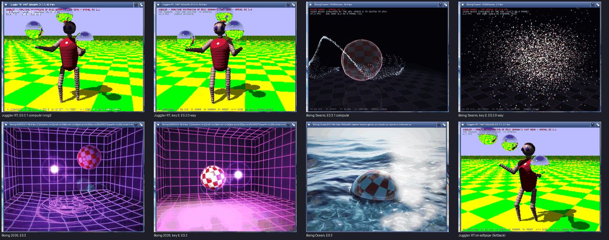

# ogles3.library on GFOpenGPU

OpenGL ES 3.1 for programs built for **ogles3.library**, drawn by GFOpenGPU's GL module (Mesa).

ogles3.library is ladislawv's OpenGL ES 3.1 for AmigaOS 3.x on the PiStorm (Emu68, the Raspberry Pi's V3D): <https://github.com/ladislawv/ogles3>. Its API and its four demos (Juggler RT, Boing Swarm, Boing 2026, Boing Ocean) are his and R-Typer's work. This library gives AmiCradle instances the same interface on the PC's graphics chip, so programs built with ogles3's SDK run here unchanged.



*ladislawv's four ogles3 1.0-beta2 demos, unchanged binaries, on a scratch copy of the Games Workshop instance (OS 3.2, AC090 68040, ACRTG, virglrenderer 1.3.0 on an AMD RX 460), 6 November 2026. The last picture is the softpipe fallback.*

## What it is

ogles3.library is a face of the one library (DESIGN.md section 5), like Warp3D.library and minigl.library, and it holds no GL of its own.

- **Its interface.** It keeps ogles3's interface:
  - the name `ogles3.library`, version 1;
  - its two vectors: -30 answers the dispatch table, and -36 (ogles3's private log flush) answers 0;
  - its dispatch table: ABI 1, 380 entries, 1,536 bytes.

  `ogles3_api.txt` lists the table in ABI order, taken from ogles3's MIT SDK header with its notice. `gen_ogles3.py` makes the table and the GL entries from it at build time.
- **GL calls.** Each GL entry (`ogles3_call.s`) forwards to the call of the same name in `LIBS:GFOpenGPU/GL.module`, with A4 on the calling program's own copy of Mesa's data. When a program's stack is under 256 KB, the call runs on a 1 MB GL stack, as libGL.a does for programs. An extension's name that the module lacks (`glFooOES`) goes to the core call it became (`glFoo`).
- **Contexts.** The agl calls (`ogles3_lib.c`) map onto the GLA core:
  - **Versions.** A context is ES 3.1 by default. `OGLES3_CCT_PISTORM_ES_VERSION` 20 asks for ES 2.0, and 30 or 31 for 3.1.
  - **Where it draws.** `OGLES3_CCT_WINDOW` draws into the program's window. `OGLES3_CCT_MODEID` opens a screen of its own, with a backdrop window for input, and GFOpenGPU draws straight into its bitmap. `OGLES3_CCT_BITMAP` draws into the program's bitmap. With none of these it opens a 640x480 window of its own.
  - **Depth, stencil and vsync.** `DEPTH`, `STENCIL` and `VSYNC` are honoured.
  - **Outputs.** `GET_WIDTH`, `GET_HEIGHT` and `PISTORM_GET_WINDOW` are filled in.
  - **Sharing.** Contexts with `SHARE_WITH` share objects.
- **Sessions.** Each task that makes contexts gets a session: its own opening of GL.module and a GLA display.
  - The display uses **virgl** when gfopengpu.library carries it (the PC's GPU), and **softpipe** on the 68k otherwise.
  - `SetEnv OGLES3/Driver CPU` makes the next session use softpipe.
- **No GFOpenGPU, no open.** Without gfopengpu.library 0.5 or later, the library won't open. A program's `OGLES3Open` then goes on to the ogles3.library in its own drawer, as ogles3's import library does.

## Installing: AmiCradle instances only

`Install-ogles3` (an Installer script, shipped beside `libs/ogles3.library`) installs it into `LIBS:`, but:

- **Only on AmiCradle.** It refuses a machine without `LIBS:GFOpenGPU/ACRTG.gpu` (the AmiCradle board's GFOpenGPU driver) and `LIBS:GFOpenGPU/GL.module`. So it never runs on a PiStorm.
- **Never over another one.** It stops, and leaves the file alone, when `LIBS:ogles3.library` is another ogles3.library. A copy is this one only if its version string says "on GFOpenGPU".

Programs that bring ladislawv's library in their own `libs/` drawer still find the installed one first. This is ogles3's own search order: `LIBS:`, then `PROGDIR:libs/`, then `PROGDIR:`.

## Build

```
STOVE=~/AmiCradle/stoves/os32-gcc16-open6 sh library/ogles3/build-amiga.sh [OUT_DIR]
```

Or use the Cradle's `stove_build`, target `library/ogles3`, stove `os32-gcc16-open6`. It builds with GCC 16.2 (open6) and gives:

- `libs/ogles3.library`, about 37 KB;
- `OGLES3Check`, which prints what a context offers (GL strings, compute limits) and runs a compute shader;
- `Install-ogles3`.

`tests/ogles3/test_ogles3_demos.sh` checks the generated table. It also fetches ladislawv's demos, at a pinned commit and SHA-256, into `OUT/ogles3-demos` for a lab. The demos are MIT. They are never committed, and their own V3D library and V3D shader binaries are left out.

## Measured, 6 November 2026

On a scratch copy of the Games Workshop instance (AC090 68040, ACRTG, virgl on an AMD RX 460), at 640x480 in a window. Each figure comes from the demo's own `FRAMES=n` count.

| Demo | OpenGL ES 3.x way | The ES 2.0 way (key E / `ES2`) |
| --- | --- | --- |
| Juggler RT, 1987 (HAM, 320x200 traced) | 261 to 287 fps | 280 fps |
| Juggler RT, 2026 (`MODERN`) | 329 fps | 185 fps |
| Boing Swarm (16,384 boids, compute) | 301 fps | 5.0 fps (the 68k simulates the boids) |
| Boing 2026 (MSAA 4x asked) | 90 fps | 100 fps |
| Boing Ocean | 115 fps | 195 to 211 fps |

- **Against the PiStorm.** ladislawv gives Juggler RT 60 fps at 640x480 on an A1200 with a Pi 4.
- **On softpipe.** With `OGLES3/Driver CPU` the same binaries run on the 68k: Juggler RT ES 3.1, compute shaders included, at 0.1 fps.
- **What OGLES3Check gets.**
  - On virgl: `OpenGL ES 3.1 Mesa 26.2.4`, `virgl (AMD Radeon RX 460 Graphics (radeonsi, polaris11, ACO...)`, GLSL ES 3.10 and 145 extensions. `GL_MAX_COMPUTE_WORK_GROUP_INVOCATIONS` is 1024, and its compute shader writes 256 of 256 values right.
  - On softpipe: the same version, 131 extensions, 1024 invocations, 256 of 256.

## Not yet

- **ES 2.0 contexts.** An ES 2.0 context comes from Mesa as its highest ES version, so `GL_VERSION` reads "OpenGL ES 3.1". ogles3 says "OpenGL ES 2.0" there, and takes GLSL ES 1.00 only. The demos don't mind.
- **Multisampling.** `OGLES3_CCT_PISTORM_MSAA` and `ENV:OGLES3/MSAA` are accepted, but the default framebuffer isn't multisampled: GLA has no samples setting yet. Framebuffer objects multisample as Mesa does.
- **`.v3dp` binaries.** `glProgramBinaryOES` with ogles3's V3D binaries (`.v3dp`) can't work on another GPU. Programs must give GLSL, as the four demos do.
- **Screenshots at full speed.** Cradle's screenshot tool can't read the RTG screen while virgl writes frames into it hundreds of times a second. The pictures above were taken with `VSYNC`, or between bursts.

## How it was written

The Team wrote this library from ogles3's public interface only:

- its MIT headers (`include/libraries/ogles3.h`, `ogles3_dispatch.h`, `include/clib/ogles3_protos.h`);
- its MIT import library's source (`client/`), for the library vectors and how `OGLES3Open` checks the table;
- its autodoc (`ogles3.doc`), README and licence;
- the demos' MIT sources and binaries.

None of ogles3's library implementation was read: not `v3dcore/`, the `ogles3/` sources or `tools/builtin_shaders/`.

## Licence

MIT, Copyright (c) 2026 Dalsin Limited / the AmiCradle Team (`LICENSE`). The dispatch table's order, names and prototypes (`ogles3_api.txt`) are from ogles3's MIT SDK, Copyright (c) 2026 R-Typer and Ladislawv, and its notice is kept there.
