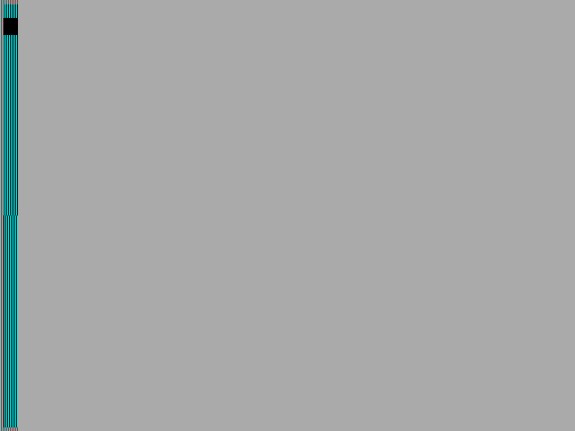
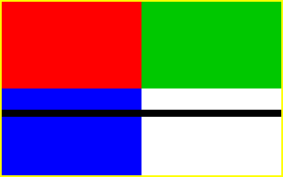
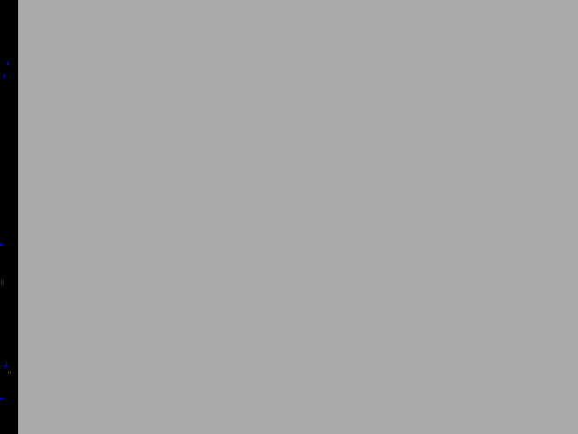
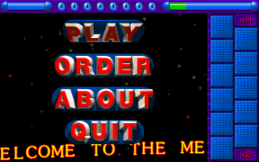
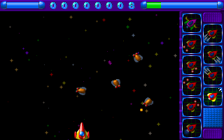
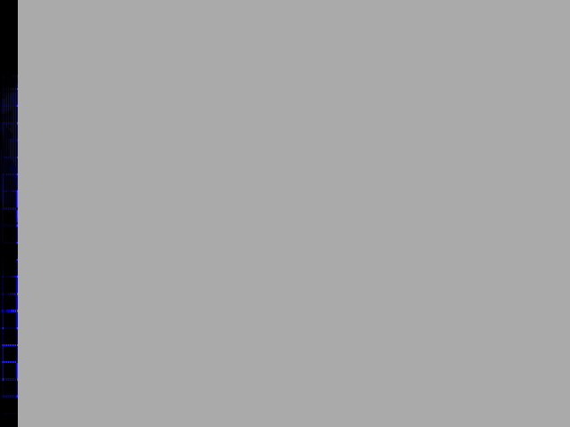
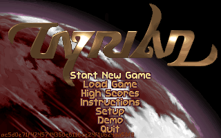
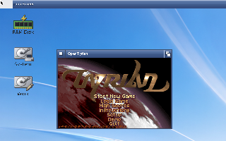

# SDL2 real full screen: lab run, 2 November 2026

`lab:sdl2`, a copy of Instance-32 (68040 + 68882 under Cradle's runtime,
GFOpenRTG RTG board, Kickstart 47, muted). Every build by Cradle's
`stove_build` with the os32-gcc16 stove, OpenAmigaGCC 16.2.0-open4.
"Before" is `SDL2.module` built from `main` (322d6dd); "after" is this
branch's (patches/amigaos3/0013 and 0014). Each module was put in both
`LIBS:OpenGPU/` (what the game builds load) and `LIBS:GFOpenGPU/` (what
programs built with this repository's stub load).

## tests/sdl2/fullscreen

Before, `fullscreen.m surface 320 200`: three screens while full screen
(the window's own 640x480, the 320x200 SetDisplayMode opened, the
Workbench), and both SDL screens still open after the program ended; the
front screen grey but for a strip at its left edge.

```
screens full screen  3: 640x480 "SDL" (1 windows), 320x200 "SDL" (0 windows), 1920x1080 "Workbench Sc" (8 windows)
surface          FAIL  front screen 640x480, display mode 320x200, window 320x200, drawn 320x200
screens after        3: 640x480 "SDL" (0 windows), 320x200 "SDL" (0 windows), 1920x1080 "Workbench Sc" (8 windows)
closed           FAIL  3 screens open after SDL_Quit (1 before)
```



`toggle 320 200` (a window to full screen and back, twice) left 2 more
screens each way round: 7 open at the end.

After, every mode passes: `surface 320 200`, `renderer 320 200`,
`toggle 320 200`, `surface 640 480`, `desktop 320 200` (a 640x480 screen,
the desktop mode) and `renderer 400 300` (SDL's closest mode, 640x400).
One screen of the program's own while full screen, in the mode SDL reports,
drawn whole; none left after leaving full screen or ending; the window back
at 320x200 after each toggle. 32-bit modes now read `ARGB8888`.

```
created        window 320x200, flags 0x605, window's mode 320x200, display's mode 320x200 SDL_PIXELFORMAT_ARGB8888
screens full screen  2: 320x200 "SDL" (1 windows), 1920x1080 "Workbench Sc" (8 windows)
renderer         pass  front screen 320x200, display mode 320x200, window 320x200, drawn 320x200
closed           pass  1 screens open after SDL_Quit (1 before)
toggle-full-1    pass  front screen 320x200, display mode 320x200, window 320x200, drawn 320x200
toggle-window-1  pass  1 screens open after leaving full screen (1 before), drawn 320x200
```



## Powermanga --fullscreen

amigapowermanga `main` (c673089), unchanged, `powermanga --fullscreen -v`.
Before: the grey 640x480 screen with the strip, as in its README, the game
running behind it at 12.9 frames a second, and two blank screens left
after it quit. After: the game on a 320x200 screen of its own, menu and
first stage, 53.3 frames a second, "Powermanga exited normally" and no
screen left.





## OpenTyrian, SDL_WINDOW_FULLSCREEN

amigaopentyrian `team4/sdl2-real-fullscreen-20261102` (70a8d32): `main` plus
a lab-only patch that asks for `SDL_WINDOW_FULLSCREEN` where upstream asks
for `SDL_WINDOW_FULLSCREEN_DESKTOP`. Before: the garbled strip on a grey
640x480 screen. After: the title whole on a 320x200 screen; Alt+Return gives
the 320x200 Workbench window and Alt+Return again the screen; after Ctrl-C
no screen of the game's is left.




