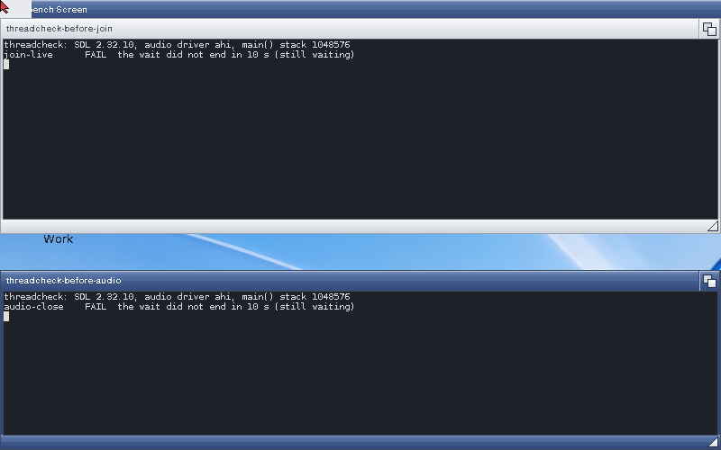
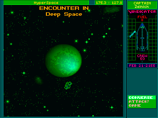
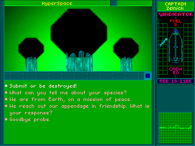

# SDL2 threads: lab run, 2 November 2026

`lab:sdl2`, a copy of Instance-32 (68040 + 68882 under Cradle's runtime,
AHI, muted). Builds by Cradle's `stove_build` with the os32-gcc16 stove,
OpenAmigaGCC 16.2.0-open4. "Before" is `SDL2.module` built from `main`
(322d6dd); "after" is this branch's (patches/amigaos3/0011 and 0012). Each
module was put in both `LIBS:OpenGPU/` (what the game builds load) and
`LIBS:GFOpenGPU/` (what programs built with this repository's stub load).

## tests/sdl2/threadcheck

Before (`threadcheck.m stack many detach`):

```
stack-default  FAIL  no hint: the thread has 32768 bytes (256 KB wanted)
stack-use      FAIL  not run: the stack is too small to use 128 KB of it
stack-hint     pass  SDL_THREAD_STACK_SIZE 65536: the thread has 65536 bytes
stack-audio    FAIL  SDL's audio thread has 32768 bytes (2 callbacks)
detach         pass  16 of 16 detached threads ran (8 detached before ending, 8 after)
many           FAIL  14 of 64 threads alive at once, all joined (No signal bits available for thread sync)
```

`threadcheck.m join` and `threadcheck.m audio` never ended: main() waiting
for a thread another thread started, and SDL_CloseAudioDevice from main()
for audio a thread opened.



After, all ten checks pass on the module (`threadcheck.m`) and linked
statically (`threadcheck`), on AHI and on Paula (`SDL_AUDIODRIVER=paula`):

```
stack-default  pass  no hint: the thread has 262144 bytes (256 KB wanted)
stack-use      pass  a thread used 128 KB of its stack (sum 196608)
stack-hint     pass  SDL_THREAD_STACK_SIZE 65536: the thread has 65536 bytes
stack-audio    pass  SDL's audio thread has 262144 bytes (2 callbacks)
join-live      pass  main() waited for a thread another thread started (that thread still running); it returned 11
join-gone      pass  main() waited for a thread another thread started (that thread already ended); it returned 11
join-ended     pass  main() waited for a thread another thread started (that thread already ended); it returned 11
detach         pass  16 of 16 detached threads ran (8 detached before ending, 8 after)
many           pass  64 of 64 threads alive at once, all joined (every one started)
audio-close    pass  opened in a thread (ahi, 24 callbacks in 1 s), closed from main()
```

Four full runs in a row moved free memory by 720 bytes.

## The Ur-Quan Masters, without its workarounds

amigauqm `team4/sdl2-workarounds-off-20261102` (37dd642): `main` without
`patches/0003-amiga-thread-stacks.patch` (the 512 KB stack hint) and
without the part of `0002-amiga-audio.patch` that closes audio in the game
thread, so main() closes it as upstream does. Sound on, default settings.

- Quit with sound on: before, by the main menu's Quit and by F10 and Yes,
  the screen went black and the process was still there 30 seconds on;
  after, by F10 and Yes (twice), the process ended and the Workbench came
  back.
- The first alien conversation (New Game, Escape, Left 2 s and Up 8 s with
  `HoldKeys`, the Slylandro probe, CONVERSE): before, the screen stayed on
  the encounter picture; after, the comm screen with the five replies, and
  the log has `'base/comm/probe/probe.txt' -- conversation phrases -- 5968
  bytes`. Quit from there returned to the Workbench.



